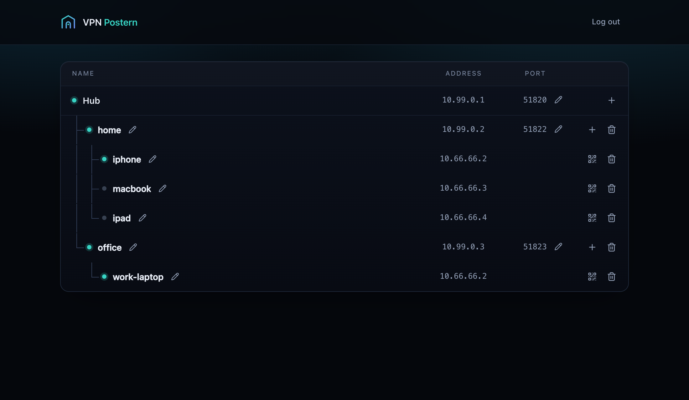
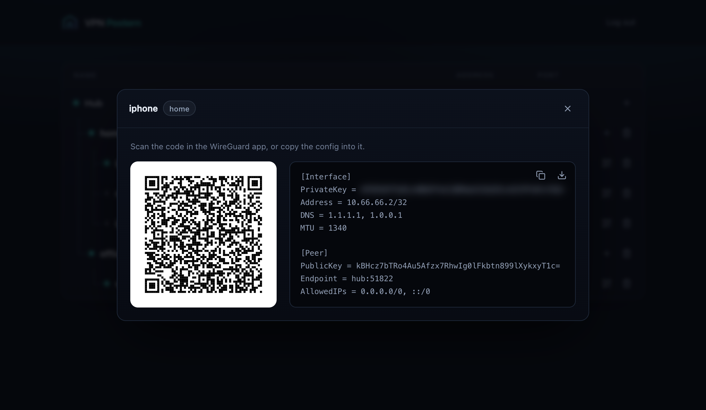

# VPN Postern

Self-hosted VPN access to networks behind NAT, with zero router configuration.

Manage home nodes (a Raspberry Pi, a NAS, any Linux box) behind NAT from one droplet.
Each node becomes a WireGuard VPN server. Phones reach it through the droplet.



## Why

- No port forwarding. Nodes dial out to the droplet, so they work behind any router, even CGNAT.
- No accounts and no third party. You own the droplet and the nodes.
- The droplet only forwards encrypted packets. It can't read your traffic.
- Phones use the official WireGuard app. Scan a QR code and you're in.

## Get started

You need an Ubuntu droplet, a Debian-based Linux box at home (such as Raspberry Pi OS) and the WireGuard app.

1. On the droplet, run:
   ```sh
   curl -fsSL https://github.com/gurhankokcu/vpn-postern/releases/latest/download/install.sh | sudo bash
   ```
2. Open `https://DROPLET_IP:8443` and log in. The certificate is self-signed, so the browser warns once.
3. Add a node, then run the join command it shows on the node.
4. Add a device to the node and scan its QR code in the WireGuard app.



If the droplet has a firewall, allow TCP 8443, and UDP on the hub's port and each node's port.

## How it works

| Term       | Meaning                                               |
| ---------- | ----------------------------------------------------- |
| Hub        | the droplet: web UI, management tunnel, port forwards |
| Node       | Linux box at home, behind NAT (e.g. a Raspberry Pi)   |
| Device     | a phone/laptop with a WireGuard config for one node   |
| `postern0` | management tunnel, hub ↔ nodes                        |
| `wg0`      | the node's VPN server, for devices                    |

```
phone ──▶ hub:P/udp ══ postern0 ══▶ node:L (wg0) ──▶ home LAN, internet
          DNAT only                  decrypts
```

- Each node dials the hub on `postern0`, which keeps its NAT open, so the hub reaches it at `10.99.0.N`.
- Each node has its own UDP port `P` on the hub. One nftables rule forwards it to the node's `wg0`; the hub never decrypts device traffic.
- A node's devices live only in its `/etc/wireguard/wg0.conf`. The hub stores nothing about them.
- The hub manages nodes over SSH through `postern0`. Nothing custom runs on a node.
- A node that hangs is rebooted by its hardware watchdog, and everything starts again on boot.
- The hub keeps its data in one file, `/var/lib/postern/data.json`: the admin password hash, the nodes and the join tokens.

## Security

- The admin UI has one password and locks an address out for 15 minutes after 5 wrong tries.
- The join command pins the hub's certificate, so a node only ever talks to your hub.
- The hub holds an SSH key that logs in to each node as root. Whoever controls the hub controls the nodes.

## Development

Try it in the simulation, a small internet in Docker Desktop described in `test/sim/README.md`:

```sh
npm run sim:up                    # start the simulation
docker exec -it hub bash          # the droplet, as root
POSTERN_SOURCE=/mnt/project bash /mnt/project/install.sh
```

The admin UI is then at `https://localhost:8443`.

Run it locally, with data in `.dev`:

```sh
npm run cert                                                  # TLS certificate
npm run set-password                                          # admin password
ssh-keygen -q -t ed25519 -N '' -C postern -f .dev/id_ed25519  # hub SSH key
npm run server                                                # https://localhost:8443
```

`dev/bin/wg` stands in for WireGuard: nodes show offline unless `.dev/handshakes` lists
their key and last handshake time.

Test:

```sh
npm test     # unit tests
npm run e2e  # end to end, in the simulation; the last file drives headless Chrome
```

## License

[MIT](LICENSE)
